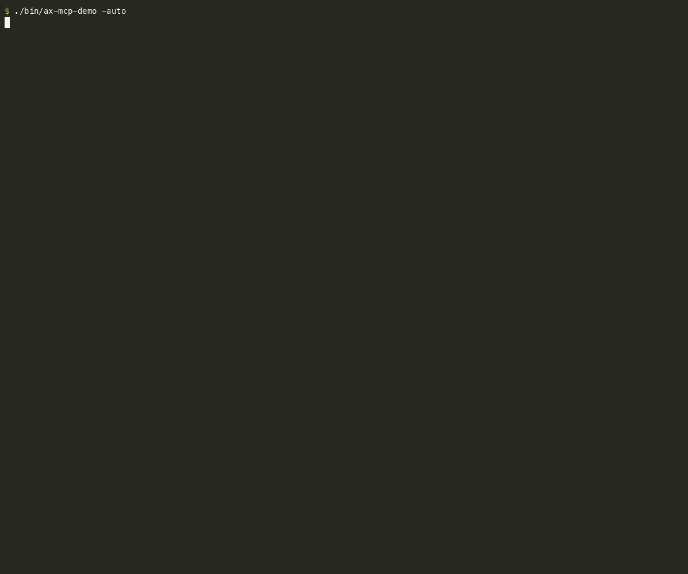

# ax-mcp: AX tasks over MCP

`ax-mcp` is an MCP server whose tool calls run as
[MCP tasks](https://modelcontextprotocol.io/specification/2025-11-25/basic/utilities/tasks),
and every MCP task is an AX task.



| MCP | AX |
|---|---|
| task-augmented `tools/call` | `CreateTask` + `ResumeTask` |
| `tasks/get`, `notifications/tasks/status` | the task's state and what the job reports |
| `input_required` + `elicitation/create` | the job asks the user a question and waits |
| `tasks/result` | the job's output once it exits |
| `tasks/cancel` | SIGTERM to the job; what it writes on the way out is the result |
| `tasks/list` | `ListTasks` |

ax-mcp keeps no state: everything lives in AX, so you can kill ax-mcp
mid-flight and a new one picks up every task.

## Run the demo

You need a running AX cluster (`ax local start`) and `ax` on `PATH`.

```bash
make demo        # you answer the forecast job's question
make demo-auto   # answers it for you
```

A data science agent asked *"why did Q3 revenue dip, and what's next?"* starts
five jobs as MCP tasks:

- **profile** finds the cause: APAC app orders down 60% from Aug 14
- **retention** trains a churn model on 200k customers
- **forecast** asks whether to drop, clip or keep 37 bulk orders, then forecasts four weeks
- **tune** runs a grid search that would take over an hour, so the agent cancels it
- **etl** loads September's payments and quarantines two bad rows

Along the way the demo kills ax-mcp and recovers every task with `tasks/list`.
At the end it deletes the AX tasks (`-keep` leaves them).

## Use it from an MCP client

```bash
make build
claude mcp add ax-tasks -- $PWD/bin/ax-mcp
```

## Writing jobs

A job is a Python program that ax-mcp runs in its own AX task. It talks to
the MCP client through the `axmcp` module, which ax-mcp provides:

| Call | MCP effect |
|---|---|
| `axmcp.status(message)` | sets the task's `statusMessage` |
| `axmcp.ask(message, schema)` | moves the task to `input_required` and asks the user through `elicitation/create`; blocks until they answer |
| `axmcp.result(text)` | sets the text of the tool result |

```python
import axmcp

for i in range(1, 11):
    axmcp.status(f"step {i}/10")

answer = axmcp.ask(
    "Found 3 duplicate rows. Drop them?",
    {
        "type": "object",
        "properties": {"drop": {"type": "boolean", "title": "Drop duplicates"}},
        "required": ["drop"],
    },
)
if answer["action"] == "accept" and answer["content"]["drop"]:
    ...

axmcp.result("loaded 997 rows")
```

`axmcp.ask` returns the elicitation result: `action` is `accept`, `decline`
or `cancel`, and `content` holds the answers when it is `accept`.

If a job never calls `axmcp.result`, its stdout becomes the result. A non-zero
exit makes the result an error. On `tasks/cancel` the job gets SIGTERM, then
SIGKILL 5 seconds later. A job can catch SIGTERM and call `axmcp.result` to
return partial work.
